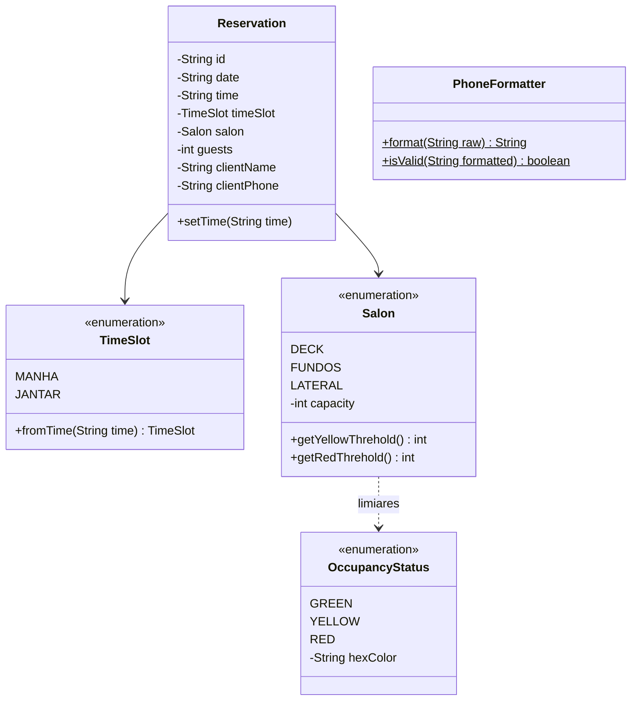

# Santa Ana — Reservas

Sistema desktop (Java 21 + JavaFX + Firestore) para o restaurante Santa Ana registrar reservas por salão e horário, substituindo o caderno escrito à mão. **Em desenvolvimento:** por enquanto existe só o modelo de domínio e um utilitário de telefone; ainda não há tela, persistência nem classe principal.

## Objetivo

- Registrar reservas (data, horário, salão, nº de pessoas, nome e telefone do cliente).
- Separar automaticamente almoço e jantar pelo horário.
- Mostrar a ocupação de cada salão com semáforo verde / amarelo / vermelho.
- Guardar os dados no Firebase Firestore (dependência `firebase-admin` já declarada no `pom.xml`).

## O que já existe

| Classe | Descrição |
|---|---|
| `model.Reservation` | Reserva. Ao definir `time` ("HH:mm"), calcula o `TimeSlot`. |
| `model.TimeSlot` | `MANHA` (antes das 17:00) e `JANTAR` (a partir das 17:00); `fromTime("19:30")` → `JANTAR`. |
| `model.Salon` | `DECK` (50 lugares), `FUNDOS` (40) e `LATERAL` (45). Limiares: amarelo em 70% e vermelho em 90% da capacidade, arredondados para cima (DECK: 35 e 45). |
| `model.OccupancyStatus` | `GREEN` "Disponível", `YELLOW` "Quase cheio", `RED` "Crítico", cada um com cor hex para a interface. |
| `util.PhoneFormatter` | `format` deveria transformar `11987654321` em `11 98765-4321`; `isValid` confere o padrão `DD NNNN(N)-NNNN`. Ver limitações. |



## Stack

Java 21, Maven, JavaFX 21.0.2 (controls + fxml), Firebase Admin SDK 9.2.0.

## Como compilar

Pré-requisitos: JDK 21+ e Maven.

```bash
mvn compile
```

`mvn javafx:run` está configurado no `pom.xml`, mas ainda não funciona: a classe `com.restaurante.reservas.MainApp` referenciada não existe. Sem Maven, o modelo compila só com o JDK:

```bash
javac -d out $(find src/main/java -name '*.java')
```

## Estrutura

```
src/main/java/com/restaurante/reservas/
├── model/   # Reservation, TimeSlot, Salon, OccupancyStatus
└── util/    # PhoneFormatter
```

## Limitações conhecidas

- **`PhoneFormatter.format` nunca formata.** A regex usa `[ˆ0-9]` com `ˆ` (U+02C6, acento circunflexo modificador) no lugar de `^`. Em vez de "tudo que não é dígito", a classe casa com `ˆ` **e** com os dígitos, então os números são apagados e o método devolve a entrada sem mudança (`11987654321` → `11987654321`, `isValid` → `false`). Trocar por `[^0-9]` resolve.
- `pom.xml` aponta `main.class` para `com.restaurante.reservas.MainApp`, que ainda não foi criada.
- Ainda não há interface, conexão com o Firestore nem testes.
- `Reservation.toString()` não tem espaço depois de "pessoas ·" e lança `NullPointerException` se o salão for nulo.
- `Salon.toString()` devolve o nome da constante (`DECK`), não o `displayName`; `getYellowThrehold`/`getRedThrehold` têm "Threshold" escrito errado.
